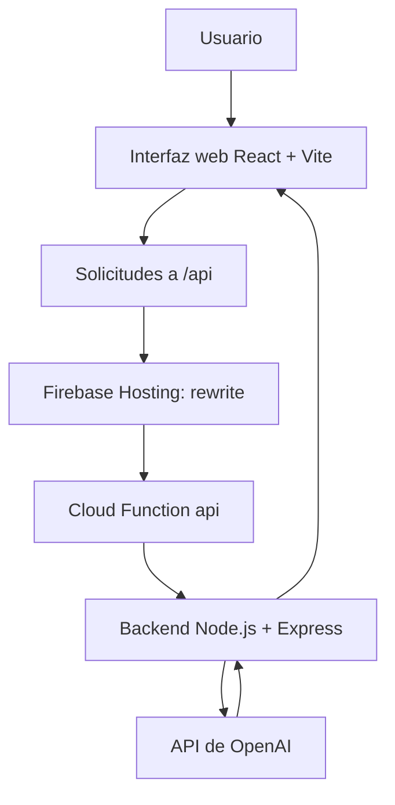

# Asistente de Economía | Inteligencia Artificial aplicada a la educación económica

<p align="center">
  
</p>

<p align="center">
  <strong>Asistente educativo para explorar conceptos de economía y negocios mediante una interfaz conversacional.</strong>
</p>

<p align="center">
  
  
  
  
  
</p>

---

## Descripción general

**Asistente de Economía** es un proyecto de software educativo orientado a facilitar el acceso a explicaciones y consultas sobre economía, finanzas y administración de negocios. Combina una aplicación web con servicios backend y capacidades de inteligencia artificial para ofrecer una experiencia de consulta conversacional.

El proyecto se relaciona con el aprendizaje y la divulgación de conocimientos económicos en un contexto universitario, incluida la Universidad del Caribe. Las respuestas generadas por IA deben utilizarse como apoyo informativo y contrastarse con fuentes confiables cuando se trate de cifras, regulaciones o decisiones relevantes.

## Objetivo

Desarrollar una herramienta digital accesible que facilite la comprensión de temas económicos y empresariales, promueva el aprendizaje autónomo y sirva como punto de partida para el análisis y la consulta de conceptos especializados.

## Funcionalidades y alcance

- Interfaz web desarrollada con **React** y **Vite**.
- Arquitectura con **Node.js**, **Express** y componentes de **Firebase Cloud Functions**.
- Integración tecnológica con la **API de OpenAI** para capacidades de IA conversacional.
- Configuración para publicación mediante **Firebase Hosting**.
- Organización del proyecto en frontend, backend y archivos de configuración.
- Enfoque educativo sobre economía y negocios.

> **Nota de alcance:** la disponibilidad de cada función depende de la configuración del entorno, las credenciales y el estado del despliegue. Este repositorio no debe interpretarse como un servicio de asesoría financiera profesional ni como fuente de datos económicos en tiempo real.

## Arquitectura general



El archivo `firebase.json` dirige las solicitudes `/api/**` a la función `api` en `us-central1` y sirve el frontend compilado desde `dist/`.

## Tecnologías principales

| Capa | Tecnologías |
| --- | --- |
| Interfaz | React 18, React DOM, Vite 4 |
| Servidor | Node.js 22, Express |
| Inteligencia artificial | SDK de OpenAI |
| Infraestructura | Firebase Hosting, Firebase Cloud Functions |
| Utilidades | CORS, dotenv |
| Desarrollo | npm, Git, GitHub |

## Estructura del repositorio

```text
asistenteeconomia/
├── assets/
│   └── imagen_economia_github.png
├── functions/            # Funciones y dependencias backend
├── public/               # Recursos públicos del frontend
├── src/                  # Código fuente React
├── .firebaserc           # Asociación al proyecto Firebase
├── firebase.json         # Hosting, Functions y rewrites
├── index.html            # Punto de entrada web
├── package.json          # Dependencias y scripts principales
├── server.js             # Archivo de servidor presente en el proyecto
├── vite.config.js        # Configuración de Vite
└── README.md             # Documentación del proyecto
```

## Instalación y ejecución local

**Requisitos:** Node.js, npm y acceso a las credenciales requeridas por los servicios utilizados. Para desplegar en Firebase, instala además Firebase CLI y configura un proyecto autorizado.

1. Clona el repositorio:

   ```bash
   git clone https://github.com/LuisBarahonaMX/asistenteeconomia.git
   cd asistenteeconomia
   ```

2. Instala las dependencias del frontend:

   ```bash
   npm install
   ```

3. Instala las dependencias de las funciones:

   ```bash
   cd functions
   npm install
   cd ..
   ```

4. Configura las variables de entorno y credenciales necesarias, sin incluir claves privadas en Git.

5. Inicia el entorno de desarrollo de Vite:

   ```bash
   npm run dev
   ```

6. Para generar el frontend de producción:

   ```bash
   npm run build
   ```

**Importante:** iniciar Vite no inicia automáticamente las Cloud Functions. Para probar las rutas `/api` localmente, se requiere configurar el backend o los emuladores de Firebase y, cuando corresponda, un proxy de desarrollo.

## Despliegue

El proyecto contiene configuración de Firebase Hosting y Cloud Functions. Después de autenticarte, seleccionar el proyecto correcto, configurar los secretos y generar el frontend, el despliegue definido en `package.json` puede ejecutarse con:

```bash
npm run build
npm run deploy
```

Antes de desplegar, revisa la región, las credenciales, los permisos y los servicios activados en Firebase.

## Seguridad y buenas prácticas

- No publiques archivos `.env`, claves API ni credenciales de Firebase Admin.
- Mantén los secretos del backend fuera del repositorio y del código frontend.
- Valida solicitudes y limita el uso del servicio para controlar errores, abusos y costos de API.
- Revisa las respuestas de IA antes de utilizarlas en análisis o decisiones económicas importantes.
- Documenta y verifica las fuentes de cualquier indicador económico actualizado.

## Posibles líneas de evolución

- Incorporar referencias verificables a fuentes estadísticas y económicas oficiales.
- Añadir materiales didácticos y ejemplos por nivel de conocimiento.
- Implementar pruebas automatizadas y observabilidad del servicio.
- Integrar visualizaciones de indicadores cuando existan fuentes confiables de datos.
- Mejorar accesibilidad, evaluación de respuestas y control de costos.

Estas son oportunidades de desarrollo y no funcionalidades confirmadas como implementadas.

## Autor

**Luis Barahona**  
Ingeniería en Datos e Inteligencia Organizacional  
[GitHub: LuisBarahonaMX](https://github.com/LuisBarahonaMX)

Sitio Web:
[Sitio Web](https://asistente-economia.web.app/)
## Aviso de uso

Proyecto educativo y de divulgación. Su contenido no sustituye asesoría profesional financiera, fiscal, contable o legal. Las respuestas de sistemas de IA pueden contener errores y requieren verificación independiente.

---

<p align="center"><strong>Economía · Educación · Tecnología · Inteligencia Artificial</strong></p>
